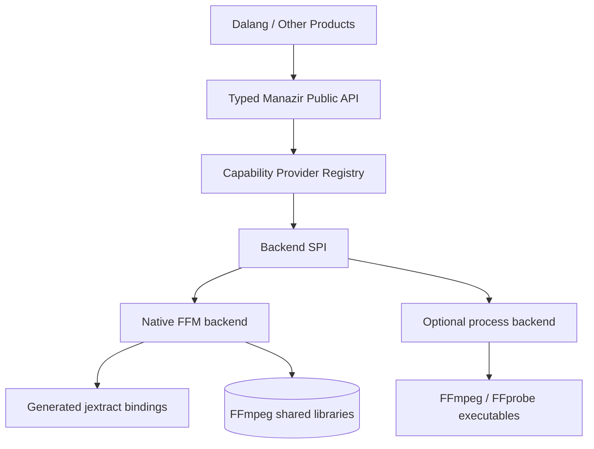
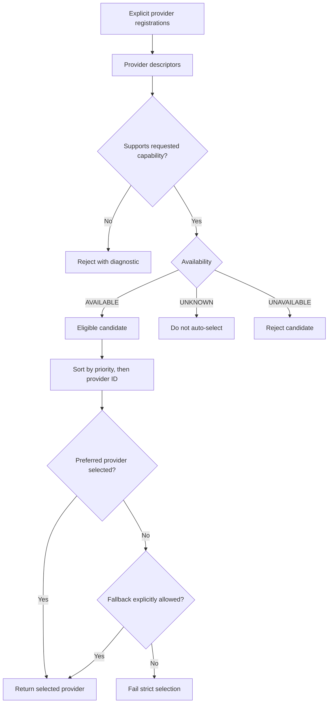
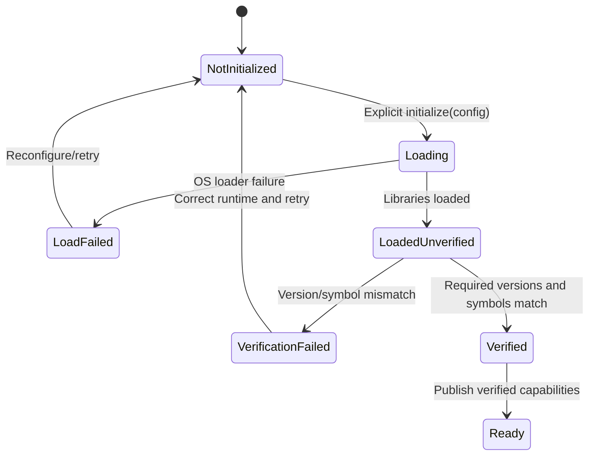
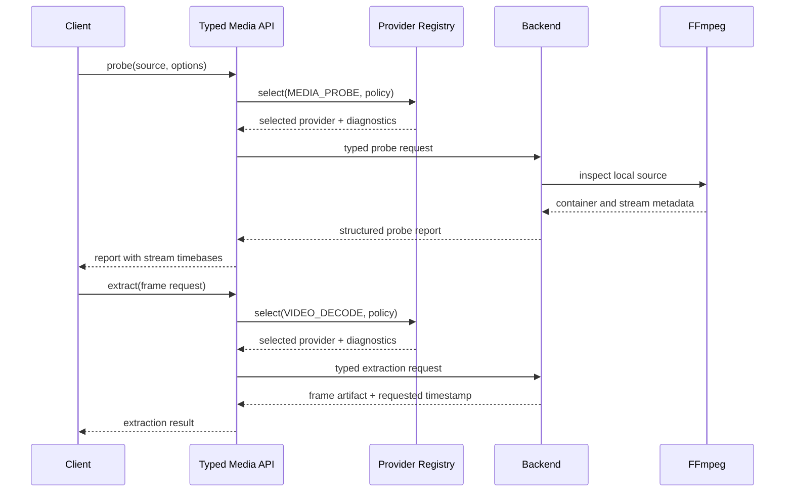
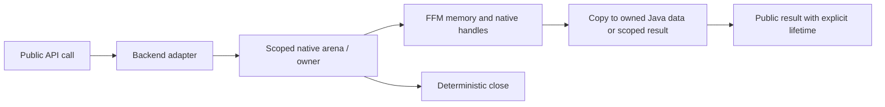

# Manazir architecture diagrams

## Layering and dependency direction

## Capability-based provider selection

## Native runtime lifecycle

## Probe and extraction sequence

## Ownership and memory lifecycle

Native segments never escape their owner lifetime. Public APIs expose owned data or explicit closeable resources.
